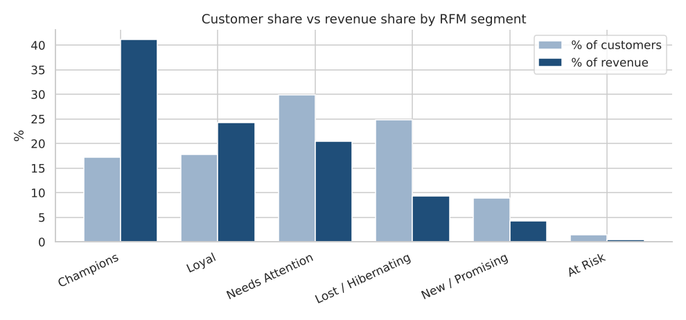

# Customer Segmentation and Sales EDA with Python (RFM + K-Means)

Exploratory analysis of retail sales data, followed by **RFM segmentation** (Recency, Frequency, Monetary) and a **K-Means** cross-check, ending in actions marketing could take for each customer group.

> **Data note:** the dataset is **synthetic**, generated by `generate_data.py` with a fixed seed (9,000 orders, 3,000 customers, 60 products, Jan 2024 to Dec 2025). It contains no real customer data. The numbers below illustrate the method and are not claims about a real business.

## What the notebook does
1. **Data validation:** null, duplicate and referential-integrity checks across four tables
2. **EDA:** monthly revenue trend, category revenue and margin, discount vs margin, order-value distribution
3. **RFM analysis:** quintile scores for recency, frequency and monetary value, and six rule-based segments (Champions, Loyal, Needs Attention, New / Promising, At Risk, Lost / Hibernating)
4. **K-Means:** log-scaled, standardised RFM features, silhouette scores for k = 2 to 7, and a 4-cluster profile compared with the rule-based segments
5. **Insights, recommendations and limitations** written from the computed results

## Key findings (synthetic data)
- Revenue grew 5.7% from 2024 to 2025, and November and December make up 20.1% of revenue, against 16.7% if spread evenly
- Electronics is 64.9% of revenue, and Office Supplies has the best margin (32.9%)
- Margin falls from 30.8% with no discount to 13.5% at a 20% discount
- **Champions are 17.2% of customers but 41.1% of revenue.** Champions plus Loyal are 34.9% of customers and 65.4% of revenue
- Lost / Hibernating customers are 24.8% of customers but only 9.4% of revenue
- K-Means (k = 4) finds a loyal high-spender cluster of about 24% of customers that brings 52.4% of revenue, and a lapsing mid-value cluster of 1,174 customers that is the largest group worth a win-back campaign



## Tools
Python, pandas, NumPy, Matplotlib, Seaborn, scikit-learn, Jupyter

## Run it
```
pip install -r requirements.txt
jupyter notebook customer_segmentation_rfm.ipynb
```
`data/` already holds the CSVs. To regenerate them, run `python generate_data.py`.

## Files
```
customer_segmentation_rfm.ipynb   executed notebook with all outputs and charts
customer_segmentation_rfm.html    the same notebook as a web page
rfm_segments.csv                  per-customer R, F, M, scores, segment and cluster
figures/                          saved charts
data/                             synthetic CSV tables
generate_data.py                  data generator
```

## Limitations
RFM scores are relative to this customer base. Returns and acquisition cost are not modelled. K-Means with k = 2 had the highest silhouette score (0.35), but k = 4 (0.33) was used because it gives more actionable groups.
